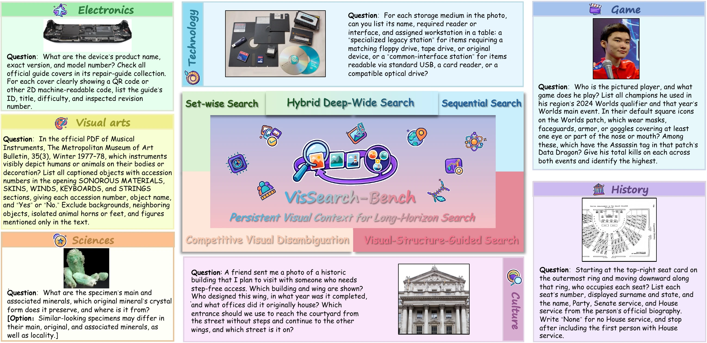
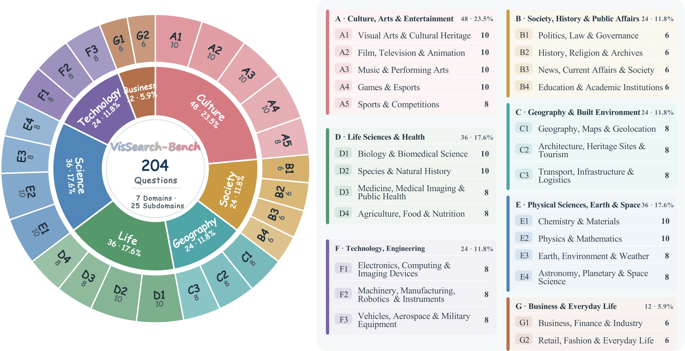
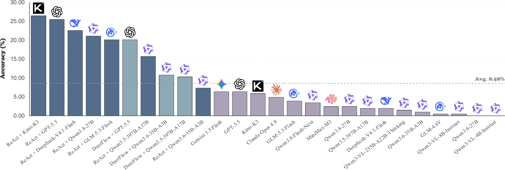
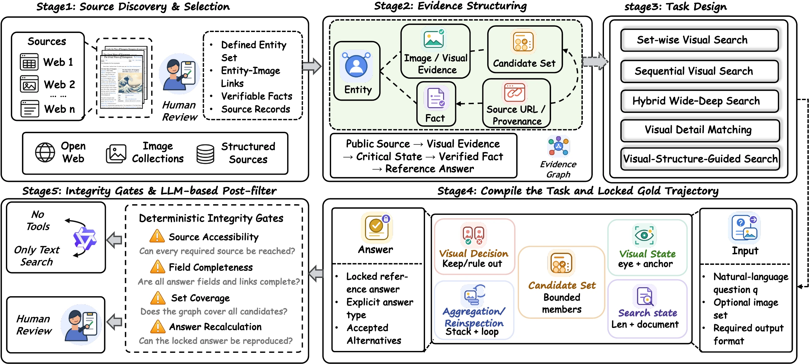

<h1 align="center">
  
  VisSearch-Bench
</h1>

<h3 align="center">Evaluating Long Horizon Visual Search in Multimodal Agents</h3>

<p align="center">
  ZhengXian Wu<sup>1,2,*,‡</sup>, Qianhao Nie<sup>1,2,*</sup>, Zhuohong Chen<sup>1,*</sup>,<br>
  Junjie Gao<sup>2</sup>, Yuyao Zhang<sup>2,3</sup>, Yunyao Yu<sup>1</sup>, Hangrui Xu<sup>1</sup>,<br>
  Cheng Cheng<sup>2</sup>, Guiyu Ma<sup>2</sup>, Jin Zhang<sup>2</sup>, Xingzhong Xu<sup>2</sup>,<br>
  Kai Yang<sup>2,†</sup>, Haoqian Wang<sup>1,†</sup>
</p>

<p align="center">
  <sup>1</sup> Tsinghua University &nbsp; <sup>2</sup> Ant Group &nbsp; <sup>3</sup> Renmin University of China<br>
  <sup>*</sup> Equal contribution &nbsp; <sup>†</sup> Corresponding authors<br>
  <sup>‡</sup> Work done during an internship at Ant Group
</p>

<p align="center">
  <a href="#" title="arXiv link coming soon"></a>
  <a href="#" title="Project page link coming soon"></a>
  <a href="https://huggingface.co/datasets/antins-labs/VisSearch-Bench-v1"></a>
  
  
  
</p>

<!-- Placeholder links: replace the two href="#" values above with the public arXiv and project-page URLs when available, and update the Coming soon badge labels. -->

<p align="center">
  <a href="#overview">Overview</a> ·
  <a href="#dataset">Dataset</a> ·
  <a href="#evaluation">Evaluation</a> ·
  <a href="#main-results">Results</a> ·
  <a href="#citation">Citation</a>
</p>

---

This is the official benchmark repository for **VisSearch-Bench: Evaluating Long Horizon Visual Search in Multimodal Agents**.

> **Can an agent keep track of what it sees as the search gets longer?**
> VisSearch-Bench evaluates how multimodal agents organize, connect, and use visual evidence across images, objects, and search steps.

<p align="center">
  <a href="assets/task-overview.webp"></a>
</p>
<p align="center"><em>Five search families, seven representative tasks. Click the figure to inspect the examples.</em></p>

---

## Status Checklist

- [x] English benchmark released on [Hugging Face](https://huggingface.co/datasets/antins-labs/VisSearch-Bench-v1).
- [x] Reference answers, evidence-linked reference solutions, and task-specific grading prompts included.
- [x] Main results for Direct Answer, ReAct, and DeerFlow documented below.
- [x] Direct and ReAct inference code, plus Accuracy and Process Score evaluation released.

---

## Overview

VisSearch-Bench focuses on **visual context management**: organizing visual information, linking it to object identities and external facts, and using those connections to guide search. Tasks require agents to inspect object appearance, compare local details, maintain complete candidate sets, or follow spatial relations across multiple search steps.

The benchmark contains **204 human-written tasks** spanning **five search families**, **seven primary domains**, and **25 secondary domains**. Every task has a reference answer, traceable evidence, and explicit scoring rules.

Across **16 multimodal models** and **26 evaluated model–setting configurations**, the best reported system fully solves **26.47%** of tasks. Search tools help, but maintaining the right visual context remains challenging.

### Task Families

| Search family | Tasks | What the agent must do |
| :--- | ---: | :--- |
| **Set-wise Visual Search** | 68 | Inspect all objects in a specified set, preserve object–evidence associations, and combine the results. |
| **Sequential Visual Search** | 34 | Carry an identity, visual clue, or fact from one search step into the next. |
| **Hybrid Wide–Deep Search** | 34 | Alternate between dependent search steps and broad candidate-set inspection. |
| **Competitive Visual Disambiguation** | 34 | Distinguish similar candidates using local visual details and source records. |
| **Visual-Structure-Guided Search** | 34 | Use an image’s order, positions, or connections to determine the search route and stopping point. |

### At a Glance

| Property | Value |
| :--- | :--- |
| Total tasks / split | **204 / test** |
| Search families | **5** |
| Primary / secondary domains | **7 / 25** |
| Tasks with initial images | **187** |
| Text-initiated tasks requiring retrieved visual evidence | **17** |
| Initial input images | **190** |
| Mean / median reference-solution steps | **17.6 / 17.0** |
| Maximum reference-solution steps | **61** |

Reference-solution steps include planning, checks, and answer preparation; they are not tool-call counts.

<details>
<summary><strong>Domain coverage: seven primary and 25 secondary domains</strong></summary>

| Primary domain | Tasks |
| :--- | ---: |
| Culture, Arts & Entertainment | 48 |
| Society, History & Public Affairs | 24 |
| Geography & Built Environment | 24 |
| Life Sciences & Health | 36 |
| Physical Sciences, Earth & Space | 36 |
| Technology, Engineering | 24 |
| Business & Everyday Life | 12 |

<p align="center">
  <a href="assets/domain-taxonomy.webp"></a>
</p>

</details>

## Dataset

The English release is available at **[antins-labs/VisSearch-Bench-v1](https://huggingface.co/datasets/antins-labs/VisSearch-Bench-v1)**. All 204 records are in the `test` split.

### Load the Dataset

```bash
pip install datasets
```

```python
from datasets import load_dataset

dataset = load_dataset(
    "antins-labs/VisSearch-Bench-v1",
    split="test",
)

task = dataset[0]
task_id = task["id"]
question = task["question_en"]
images = task["images"]  # List of PIL images; [] for text-initiated tasks.

reference_answer = task["answer"]
reference_solution = task["gold_trajectory"]
accuracy_prompt = task["accuracy_prompt"]
process_score_prompt = task["Process Score"]
```

For the paper-aligned release, pass `revision="a01927d6a0aa03552b607fd1f8b55558b2a84834"` to `load_dataset`.

### Data Fields

| Field | Content |
| :--- | :--- |
| `id` | Stable task identifier. |
| `category_name` | One of the five search families. |
| `domain` | Primary content domain. |
| `question_en` | Complete English question and output requirements. |
| `images` | Ordered initial images, with image bytes embedded in the dataset. |
| `answer` | Reference answer. |
| `gold_trajectory` | Reference solution with traceable evidence links. |
| `accuracy_prompt` | English prompt for grading complete-answer accuracy. |
| `Process Score` | English prompt for grading task-specific partial correctness and completeness. |

Both grading fields contain **prompt text**, not precomputed model scores. The task text, answers, reference solutions, and grading prompts are in English; original input images retain any text printed inside them.

## Evaluation

### Metrics

- **Accuracy (Acc.)** measures complete task success. A prediction must contain all and only the required content under the task’s matching rules. Unordered sets and ordered sequences are handled according to their respective requirements.
- **Process Score (PS)** measures the correctness and completeness of individual results and subquestion answers, using the scoring rules defined for each task.

Both metrics are reported as percentages, with higher values indicating better performance. Overall scores are micro-averages across all 204 tasks.

### Using the Grading Prompts

Provide the model with `question_en` and the ordered `images`. The reference answer, reference solution, and grading prompts are evaluation resources.

For each task’s grading prompt, replace:

| Placeholder | Value |
| :--- | :--- |
| `{{question}}` | The task’s `question_en`. |
| `{{reference_answer}}` | The task’s `answer`. |
| `{{model_answer}}` | The model’s submitted response. |

Follow the output format specified in that prompt and read its final `score`. Preserve each task’s own matching rules, scoring method, and weights. The reference solution is distinct from the actual model trajectories illustrated in the manuscript.

### Settings in the Paper

| Setting | Description |
| :--- | :--- |
| **Direct Answer** | Receives the question and initial images without external tools. |
| **ReAct** | Alternates model reasoning with web search, webpage reading, text-based image search, reverse image search, and image cropping. |
| **DeerFlow** | An additional agent framework evaluated with three selected backbones. |

Each system is evaluated once per task from a fresh context, and results are reported as **Pass@1**. The paper’s ReAct setup allows up to **30 search rounds**, **60 evidence-tool calls**, and **20 images per task**, including initial images, retrieved images, and crops. These are the ReAct limits, not a shared budget asserted for every framework.

## Inference and Evaluation Code

Direct inference, five-tool ReAct inference, and shared rubric-based evaluation are available in [`vissearch_bench/`](vissearch_bench/). Use Python 3.10+ on Linux/macOS, or WSL on Windows.

```bash
git clone https://github.com/antins-labs/VisSearch-Bench-v1.git
cd VisSearch-Bench-v1
python -m venv .venv
source .venv/bin/activate
pip install -e .
```

Configure your own model with `MODEL_NAME`, `MODEL_BASE_URL`, and `MODEL_API_KEY`. Example profiles are in [`configs/`](configs/); credentials are read from environment variables.

```bash
# Offline input check; downloads the public dataset on first use.
python -m vissearch_bench.inference --method direct \
  --config configs/openai.json --limit 2 --dry-run

# Direct Answer: question + initial images, without external tools.
python -m vissearch_bench.inference --method direct \
  --config configs/openai.json --output outputs/direct

# ReAct: also set SERPER_API_KEY and SERPAPI_KEY.
python -m vissearch_bench.inference --method react \
  --config configs/openai.json --output outputs/react

# Set JUDGE_MODEL_NAME, JUDGE_BASE_URL, and JUDGE_API_KEY first.
python -m vissearch_bench.evaluate --config configs/judge.json \
  --predictions outputs/react/predictions.jsonl --output outputs/react-evaluation
```

The commands use the pinned English Hugging Face release by default. `--limit` and `--ids` select a smaller run; `--resume` continues saved work. Evaluation reads the per-task `accuracy_prompt` and `Process Score` rubrics; use `--metric accuracy` or `--metric process` to run either metric separately.

See **[the usage guide](docs/usage.md)** for provider setup, local data, tool budgets, outputs, failure accounting, and offline tests. The public wrappers reuse the experiment inference/scoring implementations; generic example profiles do not reproduce every model-specific setting or historical retry policy in the paper.

---

## Main Results

**Kimi-K3 + ReAct** achieves the highest complete-answer accuracy (**26.47%**). **GPT-5.5 + ReAct** achieves the highest Process Score (**49.52%**). The strongest Direct Answer accuracy is **6.37%**, reached by GPT-5.5 and Gemini 3.5 Flash.

<p align="center">
  <a href="assets/main-results.webp"></a>
</p>

### Search Agents

| Model / backbone | Setting | Accuracy (%) ↑ | Process Score (%) ↑ |
| :--- | :--- | ---: | ---: |
| Kimi-K3 | ReAct | **26.47** | 38.57 |
| GPT-5.5 | ReAct | 25.49 | **49.52** |
| DeepSeek-V4.1-Flash | ReAct | 22.55 | 39.47 |
| Qwen3.8-27B | ReAct | 21.08 | 33.23 |
| GPT-5.5 | DeerFlow | 20.10 | 38.30 |
| GLM-5.3-Flash | ReAct | 20.10 | 22.29 |
| Qwen3.5-397B-A17B | ReAct | 15.69 | 32.43 |
| Qwen3.6-35B-A3B | DeerFlow | 10.78 | 24.26 |
| Qwen3.5-397B-A17B | DeerFlow | 10.29 | 28.37 |
| Qwen3.6-35B-A3B | ReAct | 7.35 | 23.25 |

<details>
<summary><strong>Direct Answer results for all 16 backbones</strong></summary>

| Model / backbone | Setting | Accuracy (%) ↑ | Process Score (%) ↑ |
| :--- | :--- | ---: | ---: |
| GPT-5.5 | Direct Answer | 6.37 | 22.61 |
| Gemini 3.5 Flash | Direct Answer | 6.37 | 22.28 |
| Kimi-K3 | Direct Answer | 5.88 | 10.24 |
| Claude Opus 4.8 | Direct Answer | 4.90 | 16.13 |
| GLM-5.3-Flash | Direct Answer | 3.92 | 8.66 |
| Qwen3.8-Flash-Next | Direct Answer | 3.43 | 11.82 |
| MiniMax-M3 | Direct Answer | 2.45 | 9.71 |
| Qwen3.8-27B | Direct Answer | 2.45 | 6.35 |
| DeepSeek-V4.1-Flash | Direct Answer | 1.96 | 12.88 |
| Qwen3.5-397B-A17B | Direct Answer | 1.96 | 12.72 |
| Qwen3-VL-235B-A22B-Thinking | Direct Answer | 1.47 | 11.37 |
| Qwen3.6-35B-A3B | Direct Answer | 0.98 | 9.55 |
| GLM-4.6V | Direct Answer | 0.49 | 9.24 |
| Qwen3-VL-8B-Instruct | Direct Answer | 0.49 | 5.83 |
| Qwen3.6-27B | Direct Answer | 0.00 | 5.53 |
| Qwen3-VL-4B-Instruct | Direct Answer | 0.00 | 5.17 |

</details>

Results are from Table 3 of the current manuscript and are reported over all **204 tasks**. Bold values mark the best overall result for each metric. Only evaluated model–setting combinations are listed.

## Dataset Construction

VisSearch-Bench follows a human-led construction process with program-assisted verification:

1. **Curate public sources.** Identify bounded entity sets, reliable entity–image links, and independently verifiable factual fields.
2. **Organize traceable evidence.** Connect entities, images, facts, and candidate sets before writing the question.
3. **Instantiate a search family.** Apply its structural constraints and pair the task with a fixed reference answer and reference solution.
4. **Verify and review.** Check source accessibility, field completeness, set coverage, answer recomputation, and unintended shortcuts. Human reviewers inspect every retained task.

<details>
<summary><strong>View the construction pipeline</strong></summary>

<p align="center">
  <a href="assets/construction.webp"></a>
</p>

</details>

## Citation

If you use VisSearch-Bench in your research, please cite the manuscript:

```bibtex
@misc{wu2026vissearchbench,
  title = {VisSearch-Bench: Evaluating Long Horizon Visual Search
           in Multimodal Agents},
  author = {Wu, ZhengXian and Nie, Qianhao and Chen, Zhuohong
            and Gao, Junjie and Zhang, Yuyao and Yu, Yunyao
            and Xu, Hangrui and Cheng, Cheng and Ma, Guiyu
            and Zhang, Jin and Xu, Xingzhong and Yang, Kai
            and Wang, Haoqian},
  year = {2026},
  howpublished = {Manuscript},
  url = {https://huggingface.co/datasets/antins-labs/VisSearch-Bench-v1}
}
```

## Contact

For questions or feedback about the benchmark, please open an [issue](https://github.com/antins-labs/VisSearch-Bench-v1/issues).
